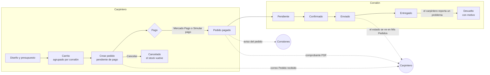

# ProMadera

Plataforma web que conecta a **carpinteros** con **corralones** de madera. El carpintero diseña un mueble, ve cuánto material necesita y cuánto cuesta, y compra los insumos a uno o varios corralones en una sola orden. Cada corralón gestiona su stock, confirma y entrega su parte del pedido, y repone mercadería a sus proveedores.

Proyecto de la materia **Prácticas Profesionalizantes II** (IES N° 6.001 Gral. Manuel Belgrano, Tecnicatura en Análisis de Software).

## Qué se puede hacer

### Carpintero
- **Diseño:** elegir un mueble estándar, ajustar las medidas y ver los materiales y el presupuesto. Los materiales se agregan al carrito con un clic.
- **Mis Proyectos:** guardar diseños, filtrarlos por ambiente y retomarlos.
- **Insumos:** catálogo con buscador y filtros por categoría y corralón; detalle con medidas y **productos que combinan**.
- **Comunidad:** combos de productos de ProMadera y de otros carpinteros; armar un combo propio con foto de portada y agregarlo al carrito.
- **Insumos con corte a medida:** en las piezas largas (tirantes, tablas, listones) se elige el largo en metros, centímetros o milímetros con un slider y el precio se calcula solo.
- **Carrito y pedidos:** la compra se separa por corralón (c1, c2…), se paga con Mercado Pago y cada corralón confirma, envía y entrega su parte. Si el material llega mal, se reporta el problema y esa parte queda como **devuelta**.
- **Correos:** al crear el pedido llega "Pedido recibido"; al confirmarse el pago llega el **comprobante de compra en PDF** y cada corralón recibe el aviso del pedido para preparar.
- **Favoritos y Localización.**

### Corralón
- **Inicio:** indicadores (ventas del mes, más vendidos, pendientes y stock bajo, desde `GET /corralones/{id}/resumen`) y accesos rápidos.
- **Mis Productos:** alta, edición y baja de productos.
- **Stock:** estado por producto (ok, bajo, agotado) con edición por fila.
- **Pedidos:** órdenes recibidas, con el detalle de lo que pidió cada carpintero.
- **Compras:** proveedores de insumos y órdenes de compra para reponer stock.

## Tecnologías

| Parte | Tecnología |
|---|---|
| Backend | Python, FastAPI, SQLAlchemy, Pydantic |
| Base de datos | PostgreSQL en Supabase |
| Frontend | React 19 y Vite |
| Pagos | Mercado Pago (Checkout Pro, credenciales de prueba) |
| Correos y comprobante | Gmail (SMTP con contraseña de aplicación) o Brevo (API, para el servidor publicado) y PDF con ReportLab |

## Estructura

```
Proyecto.Promadera/
├── tp-productos-api/          # backend
│   ├── app/api/v1/            # productos, categorias, usuarios, pedidos, pagos, compras, combos
│   └── poc_postgresql/        # modelos, conexión y scripts SQL (schema, migraciones, datos de ejemplo)
└── frontend/                  # React + Vite
    └── src/                   # App.jsx, componentes, hooks (useAuth, useCarrito, ...)
```

La API sigue tres capas: `router.py` (HTTP y validación) → `repository.py` (acceso a datos y reglas) → PostgreSQL. La documentación de cada endpoint está en Swagger.

## Cómo correrlo

### 1. Base de datos (una sola vez)

En Supabase, abrir **SQL Editor** y correr, en este orden, los archivos de `tp-productos-api/poc_postgresql/`:

1. `schema.sql`: crea todas las tablas y carga las categorías.
2. `seed_productos.sql`: deja el catálogo en 60 productos con medidas.
3. `seed_recomendaciones.sql`: 144 pares de productos que combinan.
4. `migracion_combos.sql`: tablas de combos y 6 combos de ProMadera.

Después, registrar los usuarios de demo desde la app (ver más abajo) y correr por último:

5. `seed_demo_corralones.sql`: reparte los productos entre los dos corralones.

Si la base ya existía, cada migración (`migracion_*.sql`) se puede correr sola y es segura de repetir.

### 2. Backend

```bash
cd tp-productos-api
python -m venv venv
venv\Scripts\activate                 # Windows
pip install -r requirements.txt -r requirements-postgresql.txt   # incluye reportlab (PDF)
copy .env.example .env                # completar DATABASE_URL y MP_ACCESS_TOKEN
fastapi dev app/main.py
```

La API queda en `http://127.0.0.1:8000` y Swagger en `http://127.0.0.1:8000/docs`.

Variables del `.env` (el archivo no se sube a GitHub):

| Variable | Para qué |
|---|---|
| `DATABASE_URL` | Conexión a Supabase (Connect > Connection string > URI, puerto 6543) |
| `MP_ACCESS_TOKEN` | Credencial de **prueba** de Mercado Pago. Solo va en el backend |
| `MP_BACK_URL` | Opcional: a dónde vuelve el comprador. No puede ser `localhost` |
| `MP_WEBHOOK_URL` | Opcional: URL pública del backend + `/api/v1/pagos/webhook`. Sin ella el pago real no se marca solo |
| `GMAIL_USER` | Cuenta de Gmail del proyecto que manda los correos |
| `GMAIL_APP_PASSWORD` | **Contraseña de aplicación** de 16 letras (Cuenta de Google > Seguridad > Verificación en 2 pasos > Contraseñas de aplicaciones). No es la contraseña normal. Si falta, la API funciona igual pero no manda correos |
| `BREVO_API_KEY` | Clave de la API de Brevo. Es la que se usa en el servidor publicado, porque Render bloquea el SMTP de Gmail. Si falta, la API funciona igual pero no manda correos |
| `MAIL_REMITENTE` | Dirección que figura como remitente de los correos enviados con Brevo (tiene que estar verificada en Brevo) |

### 3. Frontend

```bash
cd frontend
npm install
npm run dev
```

La app queda en `http://localhost:5173`.

## Usuarios de demo

Se registran desde la pantalla de registro de la app, con una contraseña de 8 o más caracteres:

| Nombre | Email | Rol |
|---|---|---|
| Corralón El Pino | `corralon.pino@promadera.com` | Corralón |
| Corralón Don Cedro | `corralon.cedro@promadera.com` | Corralón |
| Carpintero Demo | `carpintero@promadera.com` | Carpintero |

Los correos salen a la dirección con la que se registró cada usuario. Para ver los correos en la demo, registrar el carpintero con un correo real propio.

## Flujo de trabajo de la aplicación

El pedido tiene un **estado propio** (lo paga el carpintero) y cada corralón tiene el **estado de su parte** (lo avanza el corralón).



Reglas del flujo:
- Un pedido con productos de varios corralones se divide en una parte por corralón (c1, c2…).
- El corralón solo puede confirmar cuando el pedido está pagado, y avanza de a un paso: confirmar, enviar, entregar.
- Solo se puede reportar un problema sobre una parte **entregada** y con motivo obligatorio. La devolución no repone el stock.
- Cancelar solo se puede en pedidos pendientes de pago; devuelve el stock.
- Reposición: el corralón crea una orden de compra a un proveedor de insumos y, al recibirla, el stock sube.

## Guion de demo (unos 8 minutos)

1. **Diseño:** como carpintero, elegir un mueble, cambiar una medida y mostrar cómo se actualiza el presupuesto. Guardarlo como proyecto.
2. **Insumos:** buscar un producto, filtrar por corralón y abrir el detalle: medidas, corralón y productos que combinan.
3. **Comunidad:** abrir un combo de ProMadera y agregarlo al carrito.
4. **Carrito:** mostrar que la compra se separa en c1 y c2, uno por corralón. Crear el pedido: aparece el mensaje de pedido confirmado.
5. **Pago:** pagar (Mercado Pago o "Simular pago") y mostrar el mensaje de pago confirmado. Abrir el correo: llegó el comprobante en PDF.
6. **Corralón 1:** entrar como corralón, abrir el pedido, confirmarlo y marcarlo como enviado. Repetir con el corralón 2.
7. **Seguimiento:** volver al carpintero y mostrar en Mis Pedidos el estado de cada corralón.
8. **Devolución:** con una parte entregada, reportar un problema con el material: queda como devuelta, con su motivo.
9. **Reposición:** como corralón, ver un producto con stock bajo, crear una orden de compra a un proveedor y recibirla: el stock sube.
10. **Combo propio:** armar un combo con foto de portada y verlo en Mis combos.

## API

La documentación completa está en Swagger (`/docs`). Resumen por módulo:

| Módulo | Rutas principales |
|---|---|
| Productos | `GET/POST /productos`, `GET/PUT/DELETE /productos/{id}`, `GET /productos/{id}/recomendados` |
| Usuarios | `POST /usuarios/registro`, `POST /usuarios/login` |
| Productos (paginación) | `GET /productos?limit=12&offset=0`: el total viene en el header `X-Total-Count`. Sin `limit` devuelve todo |
| Pedidos | `GET/POST /pedidos`, `GET /pedidos/{id}`, `GET /pedidos/{id}/comprobante?usuario_id=` (PDF), `PATCH /pedidos/{id}/corralones/{proveedor_id}`, `POST /pedidos/{id}/corralones/{proveedor_id}/devolucion`, `POST /pedidos/{id}/cancelar` |
| Pagos | `POST /pagos/preferencia`, `POST /pagos/simular`, `POST /pagos/webhook` |
| Corralones | `GET /corralones/{id}/resumen` |
| Compras | `/proveedores-insumo` (listar, crear, editar, borrar) y `/ordenes-compra` (listar, crear, `PATCH …/recibir`) |
| Combos | `GET/POST /combos`, `GET /combos/{id}`, `DELETE /combos/{id}` |

## Limitaciones conocidas

- **Sin sesión con token (JWT):** el login devuelve el usuario y el frontend manda su id en cada acción. La API valida el rol y que el corralón o el cliente sean los dueños del pedido, pero alguien malicioso podría mandar un id ajeno. Es la mejora de seguridad más importante y queda en el roadmap.
- **Mercado Pago:** el webhook ya está programado (vuelve a consultar el pago en Mercado Pago antes de marcarlo como pagado), pero necesita una URL pública. Sin deploy se usa "Simular pago".
- **Comprobante:** es un comprobante de compra propio del sistema (número, fecha, ítems por corralón y total). **No es una factura fiscal de ARCA/AFIP.**
- **Correos:** salen desde Gmail (contraseña de aplicación) o, en el servidor publicado, desde Brevo. Si el envío falla, el pedido y el pago igual se guardan, pero no hay reenvío automático.
- **Pedidos pendientes retienen stock** hasta que se pagan o se cancelan.
- **La devolución no repone stock:** el corralón decide qué hacer con el material. No hay fotos ni reembolso.
- **El estado del pedido no se actualiza solo:** hay que apretar "Actualizar".
- **Compras:** una orden de compra no se edita ni se cancela, solo pasa de pendiente a recibida (siempre completa) y no lleva precios.
- **Mockups:** usamos los colores y las tipografías del proyecto, pero no las medidas exactas de los mockups.
- **Roadmap:** filtros por cercanía y envío, promociones, reputación, vista 3D, JWT y OAuth.

## Equipo

| Integrante | Usuario de GitHub | Aportes principales |
|---|---|---|
| Ariel Antonio Reynaga | [arielreynaga2662-lab](https://github.com/arielreynaga2662-lab) | Backend: usuarios y login, pedidos con sub-órdenes por corralón, pagos con Mercado Pago, estados y devoluciones, compras del corralón, corte a medida, correos con Gmail, comprobante en PDF, paginación |
| Daniela Luz Belén Camacho | [daniicamacho27](https://github.com/daniicamacho27) | Frontend: panel del corralón, Diseño, Mis Proyectos, carrito por corralón, Mis Pedidos |
| Joaquín Jairo Arzadum | [JoakoARZ](https://github.com/JoakoARZ) | Datos y medidas de productos, lógica de presupuesto, recomendaciones, pantalla de Stock, combos y Comunidad, corte a medida (slider), cuenta de Gmail, QA, documentación y video |

Sheila Sabrina Lamas Wayar ([SheiiWayar](https://github.com/SheiiWayar)) participó en la primera etapa del proyecto.
